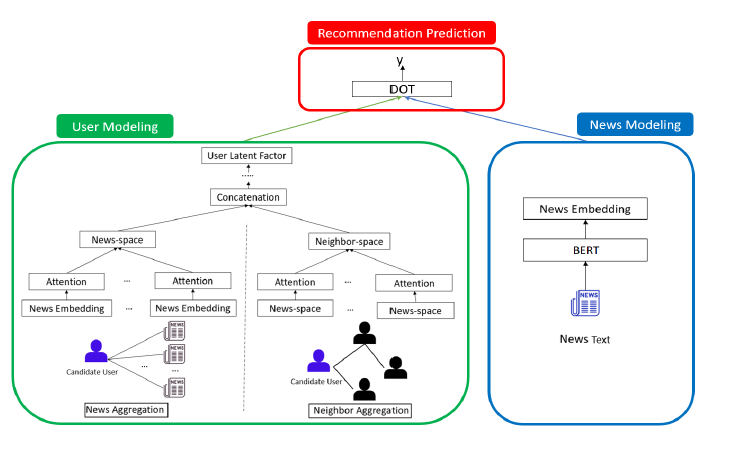
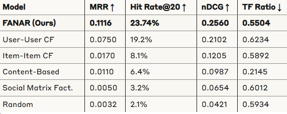
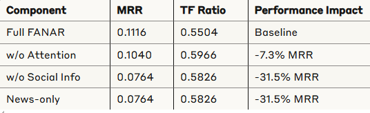

# Misinformation-Aware-News-Recommender-System

This project began as an independent implementation of the framework proposed in [Fake News Aware News Recommendation](https://dl.acm.org/doi/10.1145/3563359.3597395). Because the original authors' code and datasets were not publicly available, we implemented the architecture from the ground up to validate its claims and provide an open-source baseline for the research community.

Our implementation evaluates the design on publicly available benchmark datasets (PolitiFact/FakeHealth), compares performance against 7 classical baselines, and includes extensive ablation studies to verify the impact of semantic news-space and social neighbor-space modeling.

**Paper:** M. S. Ahmed, A. Chandnani, F. Spezzano, "Reproducibility of FANAR: Adapting a Trust-based News Recommender for Fake News Mitigation to Public Benchmarks," under review at ECIR 2027 (Reproducibility track).

## Overview
FANAR addresses the critical challenge of misinformation in news recommendation systems by implementing a hybrid user modeling approach that combines:

- **News-space modeling:** user preferences based on direct news interactions
- **Neighbor-space modeling:** aggregation over social neighbors, keeping only trustworthy users (Beta trust model, threshold 0.5)
- **Attention mechanisms:** learned weighting of articles and neighbors when building the user representation
- **BERT embeddings:** frozen `bert-base-uncased` [CLS] embeddings (768-d) for news content

## Key Achievements

- **48% higher MRR@10** than the strongest of 7 classical baselines (User-User CF) on PolitiFact (0.112 vs. 0.075)
- **Lower fake-news ratio than every collaborative-filtering baseline** on PolitiFact (TF@10 0.550 vs. 0.570–0.615 for User-User, Item-Item and ALS)
- **Ablation:** filtering out untrustworthy neighbors improves MRR@10 by 18.8% (0.112 vs. 0.0936)
- Evaluated on two public benchmarks (FakeNewsNet PolitiFact, FakeHealth) with a trustworthiness-threshold sensitivity analysis

## Features

- Semantic News Understanding: BERT-based news embeddings for rich content representation
- Social Network Integration: Neighbor-based filtering with reliability scoring
- Attention Mechanisms: Learnable attention weights for optimal user preference aggregation
- Comprehensive Evaluation: Multiple metrics including MRR, Hit Rate, nDCG, and Fake News Ratio
- Ablation Studies: Systematic analysis of model components
- Baseline Comparisons: Evaluation against 7 traditional recommendation algorithms

## Architecture

# Datasets
Supported Datasets
1. PolitiFact (FakeNewsNet)

- Users: 1,028 Twitter users (38% trustworthy)
- News Articles: 542 (322 fake, 220 real)
- Interactions: 20,265 user-news interactions
- Social Connections: 3,021 following relationships

2. FakeHealth HealthStory

- Users: 5,406 Twitter users (95% trustworthy)
- News Articles: 1,690 (472 fake, 1,218 real)
- Interactions: 120,124 user-news interactions
- Social Connections: 4,102 following relationships

# Results

PolitiFact Dataset Performance

Key Findings

- **PolitiFact (38% trustworthy users):** FANAR has the highest MRR@10 (0.112), a 48% improvement over the strongest baseline (User-User CF), with a lower fake-news ratio (TF@10 0.550) than all collaborative-filtering baselines.
- **FakeHealth (95% trustworthy users):** classical CF and content-based methods rank better (FANAR MRR@10 0.009, TF@10 0.400). FANAR works best when trustworthy and untrustworthy users are mixed.
- A trustworthiness threshold of 0.5 gave the best balance between ranking quality and fake-news exposure.

Ablation Study Results

# Areas for Contribution

- **Model Improvements:** enhanced attention mechanisms, new aggregation strategies
- **Evaluation Metrics:** additional fake news detection metrics
- **Scalability:** optimization for larger datasets
- **Applications:** integration with real-world news platforms
- **Research:** novel approaches to misinformation detection
